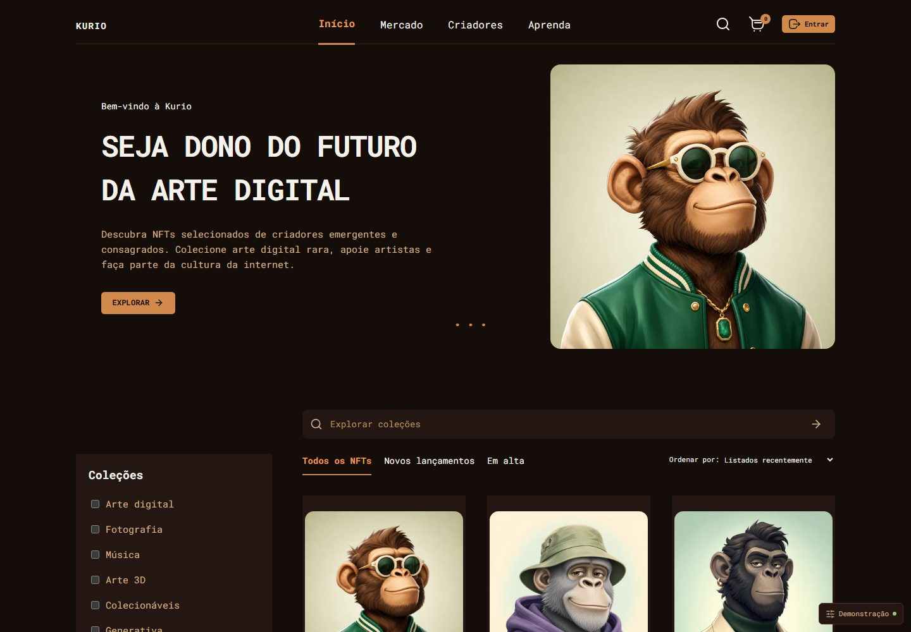
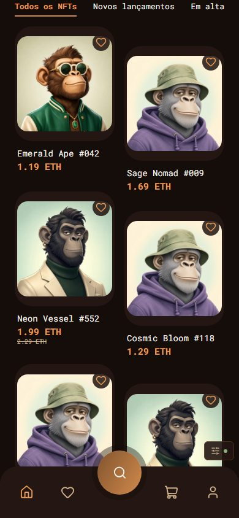
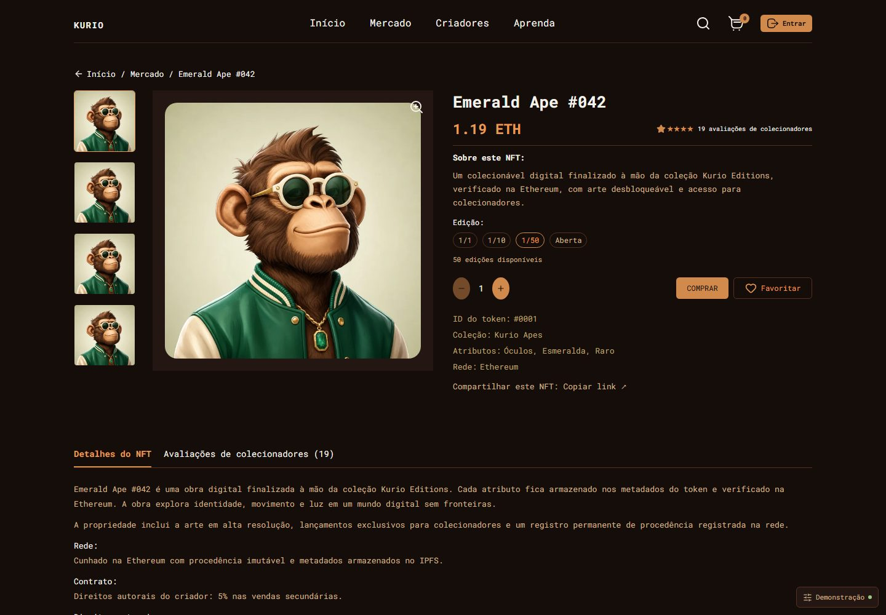

# Kurio

Marketplace de NFTs que fiz para um desafio de front-end. Foi o projeto que mais me fez estudar React, TypeScript e estado assíncrono até agora.

A aplicação não tem servidor. O MSW (Mock Service Worker) simula a API dentro do navegador e os dados ficam salvos no IndexedDB. Por isso o login, o carrinho e os pedidos continuam lá depois de atualizar a página.



## O que funciona hoje

- catálogo com busca, filtros, ordenação e paginação (o estado fica na URL);
- página do NFT com escolha de edição, quantidade, favorito e compra;
- carrinho com cupom `KURIO10` e resumo dos valores;
- checkout com escolha de carteira, revisão e confirmação do pedido;
- página do pedido que continua disponível depois de recarregar;
- login, cadastro, perfil, troca de senha e carteiras;
- preço e estoque atualizando em tempo real com Socket.IO;
- um painel de demonstração para simular erros (timeout, 503, sessão expirada etc.).

| Catálogo no mobile | Detalhe no desktop |
| --- | --- |
|  |  |

## Como rodar

Precisa de Node.js 22 ou mais novo.

```bash
npm ci
npm run dev
```

Abre em `http://localhost:5173`. Os mocks já vêm ligados. Se quiser desligar, use `VITE_ENABLE_MOCKS=false` (nesse caso é preciso ter uma API em `/api`).

Contas para testar:

| Nome | E-mail | Senha |
| --- | --- | --- |
| Nova Sato | nova@kurio.art | Kurio123! |
| Leo Costa | leo@kurio.art | Kurio123! |

São contas fictícias. Não use dados reais.

## Testes

```bash
npm run typecheck
npm run lint
npm test                 # regras de negócio
npm run build
npx playwright install chromium
npm run test:e2e         # fluxos no navegador
npm run test:visual      # screenshots e acessibilidade
```

Os testes de fluxo cobrem as 12 partes do desafio. Os visuais comparam screenshots e também rodam axe para acessibilidade.

Se a comparação visual falhar por poucos pixels em outro computador, rode `npx playwright test tests/visual.spec.ts --update-snapshots`. Isso costuma acontecer por causa da renderização da fonte em cada sistema.

## O que eu tentei aprender

- usar React Query para cache, carregamento e erro em vez de encher a tela de `useState`;
- manter o estado dos filtros na URL, para o botão voltar do navegador funcionar;
- tratar tela vazia, erro e carregamento em todos os fluxos;
- escrever testes que clicam e navegam como uma pessoa;
- cuidar do básico de acessibilidade: foco, labels, contraste e teclado;
- calcular dinheiro com `decimal.js` em vez de `number`.

## O que ainda está fraco

- o Lighthouse mobile fica em 87/88 por causa do MSW iniciando antes do React. Não consegui resolver sem tirar o mock do carregamento inicial;
- o CSS está em um arquivo só. Está separado por seções, mas ainda é grande;
- não existe backend real, então isso não serve para produção;
- algumas telas no mobile ainda podem melhorar;
- o painel de demonstração é útil para testar, mas deixa o projeto com cara de exercício.

## Estrutura

```text
src/
  contracts.ts     tipos usados na aplicação
  rules.ts         cálculos, carrinho e regras do pedido
  api.ts           Axios e React Query
  router.tsx       rotas e proteção das páginas privadas
  features/        catálogo, checkout e conta
  components/      layout, formulários, diálogos e botões
  mocks/           API falsa, dados e IndexedDB
tests/             Playwright
docs/CHALLENGE.md  enunciado do desafio
```

Se quiser entender como as partes conversam, tem um resumo em [ARCHITECTURE.md](ARCHITECTURE.md).

## Observações

O enunciado original está em [docs/CHALLENGE.md](docs/CHALLENGE.md). As imagens vieram do Figma do desafio e foram convertidas para WebP. Carteiras, pagamentos e transações são todos simulados.
